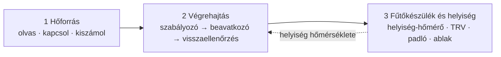
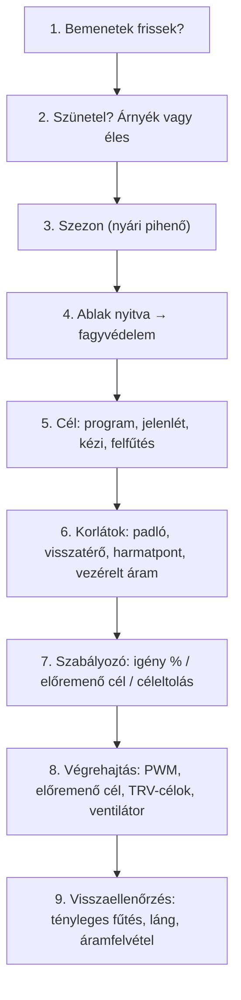

# HC Thermostat – döntési sor

Egy fűtési lépés három szinten: a hőforrás, a végrehajtás (szabályozó és beavatkozó) és a fűtőkészülék a helyiséggel – szintenként mit olvas a HC, és mit számol ki belőle. A kódból generálja a `tools/decision_chain.py`.

**kötelező** · *opció* · 📏 mérés (Beállítások → Mérések, vagy a helyiségek űrlapja) · ✅ a HC kiszámolja · 📏✅ kiszámolja, ha a mérést megadod

## A lánc

## Egy lépés, ebben a sorrendben

## 1. Hőforrások

<b>Be-ki fali kazán (relé)</b>

**Mit olvas és kapcsol**

- **Kazánt kapcsoló relé (a termosztát-bemenetre kötve)** `actuator_entity`
- *Láng-érzékelő (valódi égés)* `flame_entity`
- *Kazán fogyasztásmérője (W): készenlét / szivattyú / égés* `boiler_power_entity`
- *Hőenergia / fogyasztás (gáz m³, kWh, GJ): ebből tanulja a hőigényt* `heat_energy_entity`
- *Energiaár és kedvezményes keret: költség-tanács* `boiler_price_entity`
- *Tényleges fűtés jelzője: egyezés és hibafigyelés* `reference_entity`

**Mérések (nem kötelező)**

- 📏 Víznyomás (bar; psi, kPa, hPa, mbar átváltva) – alacsony / magas jelzés `pressure_entity`
- 📏 Valós előremenő – ΔT a visszatérővel `flow_temp_entity`
- 📏 Visszatérő hőmérséklet `return_temp_entity`
- 📏 Melegvíz-jelző (kombi kazán): közben nincs hibajelzés `hp_dhw_entity`

**Mit nyer ki**

- ✅ Kazán állapota a W-szintekből
- ✅ Tanult utánfűtés és perc/fok – kinti sávonként, a kinti hőmérséklet szerint korrigálva
- ✅ Indítások és üzemidő napra, hétre, szezonra – túl sűrű kapcsolgatás jelzés
- ✅ Ház hőigénye (kWh/nap) és hőveszteség (kW/K)
- ✅ Olcsóbb hőforrás ár és keret szerint
- ✅ Egyezés a tényleges fűtéssel, fűtési hiba

**Szabályzók (az ajánlott elöl):** **TPI + PWM** · PID + PWM · Külső termosztát

**Kezdő időzítés (ciklus / min. be / min. ki):**

- 15 perc / 5 perc / 5 perc – Radiátor, egy kör, egy termosztát, Radiátor TRV-kkel, Radiátor, zónaszelepes körök
- 1 óra / 15 perc / 15 perc – Csak padló, keverős osztó, egy zóna, Padlóosztó szelepmotorokkal
- 15 perc / 5 perc / 5 perc – Vegyes, osztókör nélkül, közös előremenő, Vegyes, padló visszatérő-korlátozóval (RTL), Vegyes, keverős osztókör saját szivattyúval
- 15 perc / 3 perc / 3 perc – Fan-coil (vizes ventilátoros hőleadó)

<b>Moduláló kazán (OpenTherm, eBUS)</b>

**Mit olvas és kapcsol**

- **Előremenő-cél (OpenTherm, eBUS) – a görbe ide írja** `flow_setpoint_entity`
- *Fűtés engedélyezése* `heat_enable_entity`
- *Láng-érzékelő* `flame_entity`
- **Kinti hőmérő (a görbéhez kötelező)** `outdoor_entity`
- *Hőenergia / fogyasztás (gáz m³, kWh, GJ): ebből tanulja a hőigényt* `heat_energy_entity`
- *Energiaár és kedvezményes keret: költség-tanács* `boiler_price_entity`
- *Tényleges fűtés jelzője: egyezés és hibafigyelés* `reference_entity`

**Mérések (nem kötelező)**

- 📏 Víznyomás (bar; psi, kPa, hPa, mbar átváltva) – alacsony / magas jelzés `pressure_entity`
- 📏 Valós előremenő – ΔT a visszatérővel `flow_temp_entity`
- 📏 Visszatérő hőmérséklet `return_temp_entity`
- 📏 Moduláció / kompresszor % `modulation_entity`
- 📏 Hibakód – csupa nulla és saját „nincs hiba” értékek nem hibák `fault_code_entity`
- 📏 Melegvíz-jelző (kombi kazán): közben nincs hibajelzés `hp_dhw_entity`

**Mit nyer ki**

- ✅ Előremenő cél saját szenzorként
- 📏✅ Valós előremenő / visszatérő, ΔT, moduláció, nyomás, hibakód
- ✅ Ház hőigénye (kWh/nap) és hőveszteség (kW/K)
- ✅ Olcsóbb hőforrás ár és keret szerint
- ✅ Egyezés a tényleges fűtéssel, fűtési hiba

**Szabályzók (az ajánlott elöl):** **Fűtési görbe + helyiségkorrekció (KÍSÉRLETI)** · TPI + PWM · PID + PWM · Külső termosztát

**Kezdő időzítés (ciklus / min. be / min. ki):**

- 15 perc / 5 perc / 5 perc – Radiátor, egy kör, egy termosztát, Radiátor TRV-kkel, Radiátor, zónaszelepes körök
- 1 óra / 15 perc / 15 perc – Csak padló, keverős osztó, egy zóna, Padlóosztó szelepmotorokkal
- 15 perc / 5 perc / 5 perc – Vegyes, osztókör nélkül, közös előremenő, Vegyes, padló visszatérő-korlátozóval (RTL), Vegyes, keverős osztókör saját szivattyúval
- 15 perc / 3 perc / 3 perc – Fan-coil (vizes ventilátoros hőleadó)

<b>Vízoldali hőszivattyú</b>

**Mit olvas és kapcsol**

- **Előremenő-cél, vagy termosztát-bemenet (on-off)** `flow_setpoint_entity`
- *Leolvasztás jelzője: közben nincs hibafigyelés* `hp_defrost_entity`
- *Melegvíz-jelző: a ház vár, nem hiba* `hp_dhw_entity`
- *Hűtés-kapcsoló (padlóhűtés)* `cool_mode_entity`
- *Hőenergia / fogyasztás (gáz m³, kWh, GJ): ebből tanulja a hőigényt* `heat_energy_entity`
- *Energiaár és kedvezményes keret: költség-tanács* `boiler_price_entity`
- *Tényleges fűtés jelzője: egyezés és hibafigyelés* `reference_entity`

**Mérések (nem kötelező)**

- 📏 Víznyomás (bar; psi, kPa, hPa, mbar átváltva) – alacsony / magas jelzés `pressure_entity`
- 📏 Valós előremenő – ΔT a visszatérővel `flow_temp_entity`
- 📏 Visszatérő hőmérséklet `return_temp_entity`
- 📏 Moduláció / kompresszor % `modulation_entity`
- 📏 Hibakód – csupa nulla és saját „nincs hiba” értékek nem hibák `fault_code_entity`
- 📏 Leadott hő (hőmennyiségmérő, kWh) – a COP-hoz `heat_output_entity`

**Mit nyer ki**

- ✅ Leolvasztás és melegvíz védve: nincs hamis hiba
- ✅ Hosszú futás védelme (minimum futás és szünet)
- 📏✅ COP ma, 7 nap, szezon (leadott hő ÷ villany)
- ✅ Ház hőigénye (kWh/nap) és hőveszteség (kW/K)
- ✅ Olcsóbb hőforrás ár és keret szerint
- ✅ Egyezés a tényleges fűtéssel, fűtési hiba

**Szabályzók (az ajánlott elöl):** **Fűtési görbe + helyiségkorrekció (KÍSÉRLETI)** · On-off, hosszú futással (hőszivattyú) · Külső termosztát

**Kezdő időzítés (ciklus / min. be / min. ki):**

- 15 perc / 5 perc / 5 perc – Radiátor, egy kör, egy termosztát, Radiátor TRV-kkel, Radiátor, zónaszelepes körök
- 1 óra / 15 perc / 15 perc – Csak padló, keverős osztó, egy zóna, Padlóosztó szelepmotorokkal
- 15 perc / 5 perc / 5 perc – Vegyes, osztókör nélkül, közös előremenő, Vegyes, padló visszatérő-korlátozóval (RTL), Vegyes, keverős osztókör saját szivattyúval
- 15 perc / 3 perc / 3 perc – Fan-coil (vizes ventilátoros hőleadó)

<b>Elektromos kazán (vizes rendszer)</b>

**Mit olvas és kapcsol**

- **Mágneskapcsoló (a kazán saját termosztátja maradjon felül)** `actuator_entity`
- *Fogyasztásmérő (W)* `boiler_power_entity`
- *Vezérelt áram jelzése* `power_available_entity`
- *Hőenergia / fogyasztás (gáz m³, kWh, GJ): ebből tanulja a hőigényt* `heat_energy_entity`
- *Energiaár és kedvezményes keret: költség-tanács* `boiler_price_entity`
- *Tényleges fűtés jelzője: egyezés és hibafigyelés* `reference_entity`

**Mérések (nem kötelező)**

- 📏 Víznyomás (bar; psi, kPa, hPa, mbar átváltva) – alacsony / magas jelzés `pressure_entity`
- 📏 Valós előremenő – ΔT a visszatérővel `flow_temp_entity`
- 📏 Visszatérő hőmérséklet `return_temp_entity`

**Mit nyer ki**

- ✅ Kazán állapota a W-szintekből
- ✅ Ház hőigénye (kWh/nap) és hőveszteség (kW/K)
- ✅ Olcsóbb hőforrás ár és keret szerint
- ✅ Egyezés a tényleges fűtéssel, fűtési hiba

**Szabályzók (az ajánlott elöl):** **TPI + PWM** · PID + PWM · Külső termosztát

**Kezdő időzítés (ciklus / min. be / min. ki):**

- 15 perc / 5 perc / 5 perc – Radiátor, egy kör, egy termosztát, Radiátor TRV-kkel, Radiátor, zónaszelepes körök
- 1 óra / 15 perc / 15 perc – Csak padló, keverős osztó, egy zóna, Padlóosztó szelepmotorokkal
- 15 perc / 5 perc / 5 perc – Vegyes, osztókör nélkül, közös előremenő, Vegyes, padló visszatérő-korlátozóval (RTL), Vegyes, keverős osztókör saját szivattyúval
- 15 perc / 3 perc / 3 perc – Fan-coil (vizes ventilátoros hőleadó)

<b>Klíma (levegő-levegő hőszivattyú)</b>

**Mit olvas és kapcsol**

- **A klíma climate entitása: a HC a célját írja**

**Mérések (nem kötelező)**

- 📏 Moduláció / kompresszor % `modulation_entity`
- 📏 Hibakód – csupa nulla és saját „nincs hiba” értékek nem hibák `fault_code_entity`
- 📏 Leadott hő (hőmennyiségmérő, kWh) – a COP-hoz `heat_output_entity`

**Mit nyer ki**

- ✅ A klíma energiája másik hőforrásként a költség-tanácshoz
- 📏✅ Kompresszor %, COP hőmennyiségmérővel

**Szabályzók (az ajánlott elöl):** **Klíma: céleltolás helyiséghőmérő szerint (virtuális i-Feel)** · Külső termosztát

**Kezdő időzítés (ciklus / min. be / min. ki):**

- 10 perc / 2 perc / 2 perc – Helyiség saját egységgel (klíma, elektromos fűtő)

<b>Elektromos fűtő (konvektor, olajradiátor, infrapanel)</b>

**Mit olvas és kapcsol**

- **Relé vagy okosdugalj** `actuator_entity`
- *Fogyasztásmérő (W): bekapcsolva, de 0 W → probléma* `boiler_power_entity`
- *Vezérelt áram jelzése* `power_available_entity`
- *Hőenergia / fogyasztás (gáz m³, kWh, GJ): ebből tanulja a hőigényt* `heat_energy_entity`
- *Energiaár és kedvezményes keret: költség-tanács* `boiler_price_entity`
- *Tényleges fűtés jelzője: egyezés és hibafigyelés* `reference_entity`

**Mit nyer ki**

- ✅ Fűtő állapota az áramfelvételből
- ✅ Fogyasztás (kWh)
- ✅ Ház hőigénye (kWh/nap) és hőveszteség (kW/K)
- ✅ Olcsóbb hőforrás ár és keret szerint
- ✅ Egyezés a tényleges fűtéssel, fűtési hiba

**Szabályzók (az ajánlott elöl):** **TPI + PWM** · PID + PWM · Külső termosztát

**Kezdő időzítés (ciklus / min. be / min. ki):**

- 30 perc / 5 perc / 5 perc – Csak padló, keverős osztó, egy zóna, Padlóosztó szelepmotorokkal
- 10 perc / 2 perc / 2 perc – Helyiség saját egységgel (klíma, elektromos fűtő)

<b>Hőtárolós kályha (vezérelt áram)</b>

**Mit olvas és kapcsol**

- **Töltő relé** `actuator_entity`
- *Kisütő ventilátor / csappantyú* `discharge_entity`
- *Vezérelt áram jelzése* `power_available_entity`
- *Hőenergia / fogyasztás (gáz m³, kWh, GJ): ebből tanulja a hőigényt* `heat_energy_entity`
- *Energiaár és kedvezményes keret: költség-tanács* `boiler_price_entity`
- *Tényleges fűtés jelzője: egyezés és hibafigyelés* `reference_entity`

**Mérések (nem kötelező)**

- 📏 Maghőmérséklet `core_temp_entity`

**Mit nyer ki**

- ✅ Töltési idő a kinti napi átlagból
- ✅ Ház hőigénye (kWh/nap) és hőveszteség (kW/K)
- ✅ Olcsóbb hőforrás ár és keret szerint
- ✅ Egyezés a tényleges fűtéssel, fűtési hiba

**Szabályzók (az ajánlott elöl):** **Hőtároló: éjszakai töltés + kisütés**

**Kezdő időzítés (ciklus / min. be / min. ki):**

- 10 perc / 2 perc / 2 perc – Helyiség saját egységgel (klíma, elektromos fűtő)

<b>Távfűtés (zónaszelep vagy szelepfejek)</b>

**Mit olvas és kapcsol**

- **Lakásonkénti zónaszelep (vagy szelepfejek külső termosztátként)** `actuator_entity`
- *Visszatérő hőmérséklet: visszatérő-korlát* `return_temp_entity`
- *Hőenergia / fogyasztás (gáz m³, kWh, GJ): ebből tanulja a hőigényt* `heat_energy_entity`
- *Energiaár és kedvezményes keret: költség-tanács* `boiler_price_entity`
- *Tényleges fűtés jelzője: egyezés és hibafigyelés* `reference_entity`

**Mérések (nem kötelező)**

- 📏 Víznyomás (bar; psi, kPa, hPa, mbar átváltva) – alacsony / magas jelzés `pressure_entity`
- 📏 Valós előremenő – ΔT a visszatérővel `flow_temp_entity`

**Mit nyer ki**

- ✅ Visszatérő-korlát
- ✅ Hőmennyiségmérő GJ / MJ / MWh → kWh, hatásfok nélkül
- 📏✅ ΔT előremenő-hőmérővel
- ✅ Ház hőigénye (kWh/nap) és hőveszteség (kW/K)
- ✅ Olcsóbb hőforrás ár és keret szerint
- ✅ Egyezés a tényleges fűtéssel, fűtési hiba

**Szabályzók (az ajánlott elöl):** **TPI + PWM** · PID + PWM · Külső termosztát

**Kezdő időzítés (ciklus / min. be / min. ki):**

- 30 perc / 10 perc / 5 perc – Radiátor, egy kör, egy termosztát, Radiátor TRV-kkel, Radiátor, zónaszelepes körök
- 1 óra / 15 perc / 15 perc – Csak padló, keverős osztó, egy zóna, Padlóosztó szelepmotorokkal
- 30 perc / 10 perc / 5 perc – Vegyes, osztókör nélkül, közös előremenő, Vegyes, padló visszatérő-korlátozóval (RTL), Vegyes, keverős osztókör saját szivattyúval
- 15 perc / 3 perc / 3 perc – Fan-coil (vizes ventilátoros hőleadó)

<b>Pellet kazán (hosszú futások)</b>

**Mit olvas és kapcsol**

- **Indító relé (hosszú futás, lassú leégés)** `actuator_entity`
- *Láng / égés jelzője* `flame_entity`
- *Puffer felső (és alsó) hőmérője* `buffer_top_entity`
- *Hőenergia / fogyasztás (gáz m³, kWh, GJ): ebből tanulja a hőigényt* `heat_energy_entity`
- *Energiaár és kedvezményes keret: költség-tanács* `boiler_price_entity`
- *Tényleges fűtés jelzője: egyezés és hibafigyelés* `reference_entity`

**Mérések (nem kötelező)**

- 📏 Víznyomás (bar; psi, kPa, hPa, mbar átváltva) – alacsony / magas jelzés `pressure_entity`
- 📏 Valós előremenő – ΔT a visszatérővel `flow_temp_entity`
- 📏 Visszatérő hőmérséklet `return_temp_entity`
- 📏 Hibakód – csupa nulla és saját „nincs hiba” értékek nem hibák `fault_code_entity`
- 📏 Füstgáz-hőmérséklet `flue_temp_entity`
- 📏 Tüzelőanyag-szint (%) – kevés tüzelőanyag jelzés `fuel_level_entity`

**Mit nyer ki**

- ✅ Puffer töltés, a körök zónaként
- ✅ Ház hőigénye (kWh/nap) és hőveszteség (kW/K)
- ✅ Olcsóbb hőforrás ár és keret szerint
- ✅ Egyezés a tényleges fűtéssel, fűtési hiba

**Szabályzók (az ajánlott elöl):** **On-off, hosszú futással (hőszivattyú)** · Külső termosztát

**Kezdő időzítés (ciklus / min. be / min. ki):**

- 1 óra / 45 perc / 20 perc – Radiátor, egy kör, egy termosztát, Radiátor TRV-kkel, Radiátor, zónaszelepes körök
- 1 óra / 15 perc / 15 perc – Csak padló, keverős osztó, egy zóna, Padlóosztó szelepmotorokkal
- 1 óra / 45 perc / 20 perc – Vegyes, osztókör nélkül, közös előremenő, Vegyes, padló visszatérő-korlátozóval (RTL), Vegyes, keverős osztókör saját szivattyúval
- 15 perc / 3 perc / 3 perc – Fan-coil (vizes ventilátoros hőleadó)

<b>Külső vezérlésű hőtermelő (csak zónaszelep; PLC, hőszivattyú saját vezérléssel)</b>

**Mit olvas és kapcsol**

- **A helyiség zónaszelepe – a hőtermelőt és a szivattyút a saját vezérlése indítja** `actuator_entity`
- *Hőenergia / fogyasztás (gáz m³, kWh, GJ): ebből tanulja a hőigényt* `heat_energy_entity`
- *Tényleges fűtés jelzője: egyezés és hibafigyelés* `reference_entity`

**Mérések (nem kötelező)**

- 📏 Víznyomás (bar; psi, kPa, hPa, mbar átváltva) – alacsony / magas jelzés `pressure_entity`
- 📏 Valós előremenő – ΔT a visszatérővel `flow_temp_entity`
- 📏 Visszatérő hőmérséklet `return_temp_entity`
- 📏 Hibakód – csupa nulla és saját „nincs hiba” értékek nem hibák `fault_code_entity`
- 📏 A hőtermelő saját állapota (pl. PLC-ből) `source_state_entity`

**Mit nyer ki**

- 📏✅ A hőtermelő állapota kiírva, hibakód-jelzés
- ✅ Ház hőigénye (kWh/nap) és hőveszteség (kW/K)
- ✅ Olcsóbb hőforrás ár és keret szerint
- ✅ Egyezés a tényleges fűtéssel, fűtési hiba

**Szabályzók (az ajánlott elöl):** **TPI + PWM** · PID + PWM · Külső termosztát

**Kezdő időzítés (ciklus / min. be / min. ki):**

- 30 perc / 10 perc / 5 perc – Radiátor, egy kör, egy termosztát, Radiátor TRV-kkel, Radiátor, zónaszelepes körök
- 1 óra / 15 perc / 15 perc – Csak padló, keverős osztó, egy zóna, Padlóosztó szelepmotorokkal
- 30 perc / 10 perc / 5 perc – Vegyes, osztókör nélkül, közös előremenő, Vegyes, padló visszatérő-korlátozóval (RTL), Vegyes, keverős osztókör saját szivattyúval
- 15 perc / 3 perc / 3 perc – Fan-coil (vizes ventilátoros hőleadó)

## 2. Végrehajtás

- **TPI + PWM** – Igény % az eltérésből és a kinti hőfokból, ebből ciklusonként be / ki idő; tanult együtthatók.
- **PID + PWM** – Arányos, integráló és deriváló tag adja az igény %-ot, abból a ciklus be-ideje; integrál-védelem.
- **Fűtési görbe + helyiségkorrekció (KÍSÉRLETI)** – Előremenő cél a kinti hőfokból, a helyiség eltérése tolja (kísérleti).
- **On-off, hosszú futással (hőszivattyú)** – Hiszterézis hosszú minimum futással és szünettel; nincs PWM.
- **Klíma: céleltolás helyiséghőmérő szerint (virtuális i-Feel)** – A klíma célját tolja a helyiséghőmérő szerint (virtuális i-Feel); nem kapcsolgatja.
- **Hőtároló: éjszakai töltés + kisütés** – Éjszakai töltés a kinti napi átlag szerint, a vezérelt áram ablakának végére; nappal kisütés.
- **Külső termosztát** – A HC egy meglévő termosztátba írja a célt (TRV, wifis fűtő), az szabályoz.

- **Relé** a ciklusban (switch / input_boolean), **előremenő cél** (number) vagy **célhőmérséklet** (climate)
- **Hasznos fűtés késése** (lassú szelep, késő szivattyú): futás = hasznos idő + késés; teljes ciklus csak, ha a hasznos igény maga eléri; a ciklus legalább késés + min. be + min. ki
- **Kis igények** a minimális égés alatt egy rendes égéssé gyűlnek (késésnél mindig; egyébként opció)
- **Utánfűtés-kivárás** égés után és **ciklus közbeni indítás** (opciók, alapból ki)
- **Nincs új indítás célcsökkenés előtt**: az ütemezett csökkenés előtt 30 percen belül (opció), ha a helyiség már most legalább olyan meleg, mint a váltás utáni cél; a futó égést nem vágja el
- **Visszaellenőrzés**: tényleges fűtés, láng, áramfelvétel – egyezés vagy hiba
- **Hibavédelem**: három egymás utáni hibás lépés kikapcsolja a fűtést (újraindítás után is); minden mellékág és beavatkozó-rész külön fut

A fan-coil a saját vízszelepét kapcsolja, bármi táplálja: TPI, PID vagy külső termosztát.

## 3. Fűtőkészülékek és helyiségek

**Minden helyiség**

- **Helyiség hőmérője (több: a helyiségcsoport átlaga)** `indoor_entity`
- *Ablakok és ajtók: nyitva fagyvédelem* `window_entities`
- *Jelenlét: háztartás vagy helyiségenként* `presence_entities`
- *Célhő forrása: a fali termosztát tekerője kézi célként* `target_source_entity`
- *Gyors hőesés: ablak érzékelő nélkül* `window_drop_entities`
- 📏 Radiátor-hőmérő helyiségenként: kap-e meleget
- 📏 Páratartalom helyiségenként: harmatpont, penész-kockázat

- ✅ Helyiségcsoportok: átlag hőmérő, közös jelenlét és ablak
- ✅ Néma szenzor felismerése: tartalék vagy fagyvédelem
- ✅ Helyiségenkénti eltérés és szelep-tanács (megfigyelt helyiségek)
- 📏✅ Hideg radiátor: a fűtési percek a PWM-szünetek között is összeadódnak; a „meleg” az előremenőhöz igazodik
- 📏✅ Harmatpont és penész-kockázat a magas páratartalmú órákból

<b>Radiátor, egy kör, egy termosztát</b>

- *Szelepfejek egyes helyiségekben: saját cél, kalibrálás* `room_trvs`
- *Megfigyelt helyiségek hőmérői (csak tanács)* `room_sensors`
- *Csatlakozó tér (pl. télikert) és ajtói* `zone_temp_entity`

<b>Radiátor TRV-kkel</b>

- **Szelepfejek: helyiségenkénti cél; a helyiség hőmérőjéhez kalibrálva** `room_trvs`

<b>Radiátor, zónaszelepes körök</b>

- **Zóna-termosztátok (HC); a központi kazán a nyitott zónákat követi** `zone_entities`
- *Szelep visszajelzése (végállás / helyzet)* `valve_feedback_entity`
- *Keringető szivattyú: utánfutás, heti átmozgatás* `pump_entity`

<b>Csak padló, keverős osztó, egy zóna</b>

- *Padlóhőmérő: felületi korlát (vizes padló 29 °C)* `floor_entity`
- ✅ Padló-temperálás, padló-tartalék, korlát a burkolat és a szenzor helye szerint

<b>Padlóosztó szelepmotorokkal</b>

- *Padlóhőmérő: felületi korlát* `floor_entity`
- *Szelepmotor visszajelzése* `valve_feedback_entity`
- ✅ Padló-temperálás, padló-tartalék, korlát a burkolat és a szenzor helye szerint

<b>Vegyes, osztókör nélkül, közös előremenő</b>

- *Padlóhőmérő: a maximuma korlátozza a közös előremenőt* `floor_entity`
- ✅ Padló-temperálás, padló-tartalék, korlát a burkolat és a szenzor helye szerint

<b>Vegyes, padló visszatérő-korlátozóval (RTL)</b>

- *Padlóhőmérő (az RTL marad a védelem)* `floor_entity`
- ✅ Padló-temperálás, padló-tartalék, korlát a burkolat és a szenzor helye szerint

<b>Vegyes, keverős osztókör saját szivattyúval</b>

- *Padlóhőmérő: a padlókör külön görbét kaphat* `floor_entity`
- ✅ Padló-temperálás, padló-tartalék, korlát a burkolat és a szenzor helye szerint

<b>Helyiség saját egységgel (klíma, elektromos fűtő)</b>

- *Elektromos padló (szőnyeg, kábel): padlószenzor kötelező, korlát 27 °C* `floor_entity`

<b>Fan-coil (vizes ventilátoros hőleadó)</b>

- **Vízszelep: a TPI / PID kapcsolja** `actuator_entity`
- *Ventilátor: fordulat az igény szerint, utánfutás* `fan_entity`
- *Hőcserélő hőmérséklete: hidegen nem indul a ventilátor* `coil_temp_entity`

## Hőforrás × fűtőkészülék

A beállítás ezt a cellát mutatja ajánlásként; cellánként az állapot és az ajánlott szabályzó.

| | Be-ki fali kazán | Moduláló kazán | Vízoldali hőszivattyú | Elektromos kazán | Klíma | Elektromos fűtő | Hőtárolós kályha | Távfűtés | Pellet kazán | Külső vezérlésű hőtermelő |
|---|---|---|---|---|---|---|---|---|---|---|
| Radiátor, egy kör, egy termosztát | ✅ TPI | ✅ görbe | ✅ görbe | ✅ TPI | ⛔ | ⛔ | ⛔ | ✅ TPI | ✅ on-off | ✅ TPI |
| Radiátor TRV-kkel | ✅ TPI | ✅ görbe | 🟡 görbe | ✅ TPI | ⛔ | ⛔ | ⛔ | ✅ TPI | ✅ on-off | ✅ TPI |
| Radiátor, zónaszelepes körök | ✅ TPI | ✅ görbe | 🟡 görbe | ✅ TPI | ⛔ | ⛔ | ⛔ | ✅ TPI | ✅ on-off | ✅ TPI |
| Csak padló, keverős osztó, egy zóna | ✅ TPI | ✅ görbe | ✅ görbe | ✅ TPI | ⛔ | ✅ TPI | ⛔ | ✅ TPI | ✅ on-off | ✅ TPI |
| Padlóosztó szelepmotorokkal | ✅ TPI | ✅ görbe | ✅ görbe | ✅ TPI | ⛔ | ✅ TPI | ⛔ | ✅ TPI | ✅ on-off | ✅ TPI |
| Vegyes, osztókör nélkül, közös előremenő | ⛔ | 🟡 görbe | 🟡 görbe | ⛔ | ⛔ | ⛔ | ⛔ | 🟡 TPI | ✅ on-off | ✅ TPI |
| Vegyes, padló visszatérő-korlátozóval (RTL) | 🟡 TPI | 🟡 görbe | ⛔ | 🟡 TPI | ⛔ | ⛔ | ⛔ | 🟡 TPI | ✅ on-off | ✅ TPI |
| Vegyes, keverős osztókör saját szivattyúval | ✅ TPI | ✅ görbe | 🟡 görbe | ✅ TPI | ⛔ | ⛔ | ⛔ | 🟡 TPI | ✅ on-off | ✅ TPI |
| Helyiség saját egységgel (klíma, elektromos fűtő) | ⛔ | ⛔ | ⛔ | ⛔ | ✅ eltolás | ✅ TPI | ✅ töltés | ⛔ | ⛔ | ⛔ |
| Fan-coil (vizes ventilátoros hőleadó) | ✅ TPI | ✅ TPI | ✅ TPI | ✅ TPI | ⛔ | ⛔ | ⛔ | ✅ TPI | ✅ TPI | ✅ TPI |

✅ ajánlott · 🟡 lehetséges · ⛔ nem ajánlott
