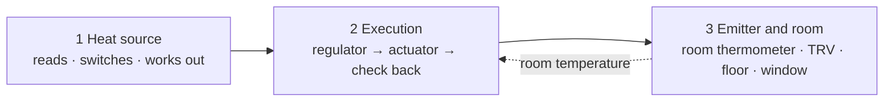
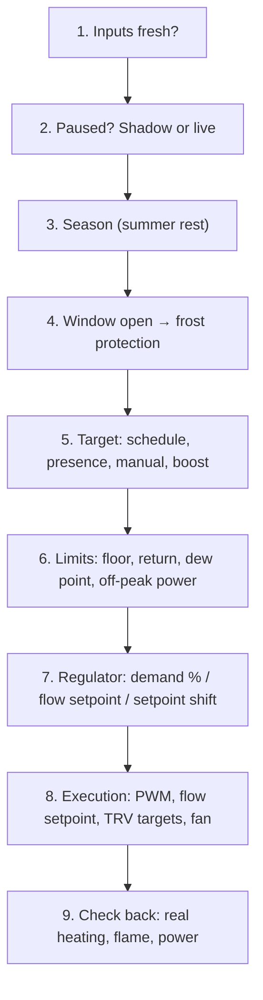

# HC Thermostat – decision chain

One heating step on three levels: the heat source, the execution (regulator and actuator) and the emitter with its room – what HC reads at each level and what it works out. Generated from the code by `tools/decision_chain.py`.

**required** · *option* · 📏 measurement (Settings → Measurements, or the rooms form) · ✅ HC works it out · 📏✅ worked out when the measurement is given

## The chain

## One step, in this order

## 1. Heat sources

<b>On/off boiler (relay)</b>

**Reads and switches**

- **Boiler relay (the room thermostat input)** `actuator_entity`
- *Flame signal (real burning)* `flame_entity`
- *Boiler power meter (W): standby / pump / burning* `boiler_power_entity`
- *Heat energy / consumption (gas m³, kWh, GJ): the heat need is learned from it* `heat_energy_entity`
- *Energy price and discounted allowance: the cost advice* `boiler_price_entity`
- *Real heating signal: agreement and fault watch* `reference_entity`

**Measurements (optional)**

- 📏 Water pressure (bar; psi, kPa, hPa, mbar converted) – low / high alert `pressure_entity`
- 📏 Real flow temperature – ΔT with the return `flow_temp_entity`
- 📏 Return temperature `return_temp_entity`
- 📏 Hot water signal (combi boiler): no fault meanwhile `hp_dhw_entity`

**Works out**

- ✅ Boiler health from the power levels
- ✅ Learned after-heat and minutes per degree – per outdoor band, corrected by the outdoor temperature
- ✅ Starts and run time per day, week, season – too many starts an hour alert
- ✅ House heat need (kWh/day) and heat loss (kW/K)
- ✅ Cheaper heat source by price and allowance
- ✅ Agreement with the real heating, heating fault

**Controls (recommended first):** **TPI + PWM** · PID + PWM · External thermostat

**Starting timing (cycle / min. on / min. off):**

- 15 min / 5 min / 5 min – Radiators, one loop, one thermostat, Radiators with TRVs, Radiators, zone valve loops
- 1 h / 15 min / 15 min – Floor only, mixing manifold, one zone, Floor manifold with valve actuators
- 15 min / 5 min / 5 min – Mixed, no separate circuit, shared flow, Mixed, floor with return limiter (RTL), Mixed, mixing circuit with own pump
- 15 min / 3 min / 3 min – Fan coil (water fed fan unit)

<b>Modulating boiler (OpenTherm, eBUS)</b>

**Reads and switches**

- **Flow setpoint (OpenTherm, eBUS) – the curve writes it** `flow_setpoint_entity`
- *Heating enable switch* `heat_enable_entity`
- *Flame signal* `flame_entity`
- **Outdoor thermometer (the curve needs it)** `outdoor_entity`
- *Heat energy / consumption (gas m³, kWh, GJ): the heat need is learned from it* `heat_energy_entity`
- *Energy price and discounted allowance: the cost advice* `boiler_price_entity`
- *Real heating signal: agreement and fault watch* `reference_entity`

**Measurements (optional)**

- 📏 Water pressure (bar; psi, kPa, hPa, mbar converted) – low / high alert `pressure_entity`
- 📏 Real flow temperature – ΔT with the return `flow_temp_entity`
- 📏 Return temperature `return_temp_entity`
- 📏 Modulation / compressor % `modulation_entity`
- 📏 Fault code – all zeros and own "no fault" values are no fault `fault_code_entity`
- 📏 Hot water signal (combi boiler): no fault meanwhile `hp_dhw_entity`

**Works out**

- ✅ Flow setpoint as a sensor
- 📏✅ Real flow / return, ΔT, modulation, pressure, fault code
- ✅ House heat need (kWh/day) and heat loss (kW/K)
- ✅ Cheaper heat source by price and allowance
- ✅ Agreement with the real heating, heating fault

**Controls (recommended first):** **Heating curve + room correction (EXPERIMENTAL)** · TPI + PWM · PID + PWM · External thermostat

**Starting timing (cycle / min. on / min. off):**

- 15 min / 5 min / 5 min – Radiators, one loop, one thermostat, Radiators with TRVs, Radiators, zone valve loops
- 1 h / 15 min / 15 min – Floor only, mixing manifold, one zone, Floor manifold with valve actuators
- 15 min / 5 min / 5 min – Mixed, no separate circuit, shared flow, Mixed, floor with return limiter (RTL), Mixed, mixing circuit with own pump
- 15 min / 3 min / 3 min – Fan coil (water fed fan unit)

<b>Hydronic heat pump</b>

**Reads and switches**

- **Flow setpoint, or its thermostat input (on/off)** `flow_setpoint_entity`
- *Defrost signal: no fault watch meanwhile* `hp_defrost_entity`
- *Hot water signal: the house waits, no fault* `hp_dhw_entity`
- *Cooling switch (floor cooling)* `cool_mode_entity`
- *Heat energy / consumption (gas m³, kWh, GJ): the heat need is learned from it* `heat_energy_entity`
- *Energy price and discounted allowance: the cost advice* `boiler_price_entity`
- *Real heating signal: agreement and fault watch* `reference_entity`

**Measurements (optional)**

- 📏 Water pressure (bar; psi, kPa, hPa, mbar converted) – low / high alert `pressure_entity`
- 📏 Real flow temperature – ΔT with the return `flow_temp_entity`
- 📏 Return temperature `return_temp_entity`
- 📏 Modulation / compressor % `modulation_entity`
- 📏 Fault code – all zeros and own "no fault" values are no fault `fault_code_entity`
- 📏 Heat given off (heat meter, kWh) – the COP `heat_output_entity`

**Works out**

- ✅ Defrost and hot water protected: no false fault
- ✅ Long-run protection (minimum run and pause)
- 📏✅ COP today, 7 days, season (heat given off ÷ power)
- ✅ House heat need (kWh/day) and heat loss (kW/K)
- ✅ Cheaper heat source by price and allowance
- ✅ Agreement with the real heating, heating fault

**Controls (recommended first):** **Heating curve + room correction (EXPERIMENTAL)** · On/off, long runs (heat pump) · External thermostat

**Starting timing (cycle / min. on / min. off):**

- 15 min / 5 min / 5 min – Radiators, one loop, one thermostat, Radiators with TRVs, Radiators, zone valve loops
- 1 h / 15 min / 15 min – Floor only, mixing manifold, one zone, Floor manifold with valve actuators
- 15 min / 5 min / 5 min – Mixed, no separate circuit, shared flow, Mixed, floor with return limiter (RTL), Mixed, mixing circuit with own pump
- 15 min / 3 min / 3 min – Fan coil (water fed fan unit)

<b>Electric boiler (water system)</b>

**Reads and switches**

- **Contactor (keep the boiler's own thermostat above)** `actuator_entity`
- *Power meter (W)* `boiler_power_entity`
- *Off-peak power available* `power_available_entity`
- *Heat energy / consumption (gas m³, kWh, GJ): the heat need is learned from it* `heat_energy_entity`
- *Energy price and discounted allowance: the cost advice* `boiler_price_entity`
- *Real heating signal: agreement and fault watch* `reference_entity`

**Measurements (optional)**

- 📏 Water pressure (bar; psi, kPa, hPa, mbar converted) – low / high alert `pressure_entity`
- 📏 Real flow temperature – ΔT with the return `flow_temp_entity`
- 📏 Return temperature `return_temp_entity`

**Works out**

- ✅ Boiler health from the power levels
- ✅ House heat need (kWh/day) and heat loss (kW/K)
- ✅ Cheaper heat source by price and allowance
- ✅ Agreement with the real heating, heating fault

**Controls (recommended first):** **TPI + PWM** · PID + PWM · External thermostat

**Starting timing (cycle / min. on / min. off):**

- 15 min / 5 min / 5 min – Radiators, one loop, one thermostat, Radiators with TRVs, Radiators, zone valve loops
- 1 h / 15 min / 15 min – Floor only, mixing manifold, one zone, Floor manifold with valve actuators
- 15 min / 5 min / 5 min – Mixed, no separate circuit, shared flow, Mixed, floor with return limiter (RTL), Mixed, mixing circuit with own pump
- 15 min / 3 min / 3 min – Fan coil (water fed fan unit)

<b>Air conditioner (air-to-air heat pump)</b>

**Reads and switches**

- **The AC's climate entity: HC writes its setpoint**

**Measurements (optional)**

- 📏 Modulation / compressor % `modulation_entity`
- 📏 Fault code – all zeros and own "no fault" values are no fault `fault_code_entity`
- 📏 Heat given off (heat meter, kWh) – the COP `heat_output_entity`

**Works out**

- ✅ The AC's energy as the other source of the cost advice
- 📏✅ Compressor %, COP with a heat meter

**Controls (recommended first):** **AC: setpoint shift by the room thermometer (virtual i-Feel)** · External thermostat

**Starting timing (cycle / min. on / min. off):**

- 10 min / 2 min / 2 min – Room with its own unit (AC, electric heater)

<b>Electric heater (convector, oil radiator, infrared panel)</b>

**Reads and switches**

- **Relay or smart plug** `actuator_entity`
- *Power meter (W): on but 0 W → problem* `boiler_power_entity`
- *Off-peak power available* `power_available_entity`
- *Heat energy / consumption (gas m³, kWh, GJ): the heat need is learned from it* `heat_energy_entity`
- *Energy price and discounted allowance: the cost advice* `boiler_price_entity`
- *Real heating signal: agreement and fault watch* `reference_entity`

**Works out**

- ✅ Heater health from the power draw
- ✅ Consumption (kWh)
- ✅ House heat need (kWh/day) and heat loss (kW/K)
- ✅ Cheaper heat source by price and allowance
- ✅ Agreement with the real heating, heating fault

**Controls (recommended first):** **TPI + PWM** · PID + PWM · External thermostat

**Starting timing (cycle / min. on / min. off):**

- 30 min / 5 min / 5 min – Floor only, mixing manifold, one zone, Floor manifold with valve actuators
- 10 min / 2 min / 2 min – Room with its own unit (AC, electric heater)

<b>Storage heater (off-peak power)</b>

**Reads and switches**

- **Charge relay** `actuator_entity`
- *Discharge fan / damper* `discharge_entity`
- *Off-peak power available* `power_available_entity`
- *Heat energy / consumption (gas m³, kWh, GJ): the heat need is learned from it* `heat_energy_entity`
- *Energy price and discounted allowance: the cost advice* `boiler_price_entity`
- *Real heating signal: agreement and fault watch* `reference_entity`

**Measurements (optional)**

- 📏 Core temperature `core_temp_entity`

**Works out**

- ✅ Charge time from the outdoor daily mean
- ✅ House heat need (kWh/day) and heat loss (kW/K)
- ✅ Cheaper heat source by price and allowance
- ✅ Agreement with the real heating, heating fault

**Controls (recommended first):** **Storage: night charge + discharge**

**Starting timing (cycle / min. on / min. off):**

- 10 min / 2 min / 2 min – Room with its own unit (AC, electric heater)

<b>District heating (zone valve or TRV heads)</b>

**Reads and switches**

- **Flat zone valve (or TRV heads as an external thermostat)** `actuator_entity`
- *Return temperature: the return limit* `return_temp_entity`
- *Heat energy / consumption (gas m³, kWh, GJ): the heat need is learned from it* `heat_energy_entity`
- *Energy price and discounted allowance: the cost advice* `boiler_price_entity`
- *Real heating signal: agreement and fault watch* `reference_entity`

**Measurements (optional)**

- 📏 Water pressure (bar; psi, kPa, hPa, mbar converted) – low / high alert `pressure_entity`
- 📏 Real flow temperature – ΔT with the return `flow_temp_entity`

**Works out**

- ✅ Return limit
- ✅ Heat meter in GJ / MJ / MWh to kWh, no efficiency
- 📏✅ ΔT with a flow thermometer
- ✅ House heat need (kWh/day) and heat loss (kW/K)
- ✅ Cheaper heat source by price and allowance
- ✅ Agreement with the real heating, heating fault

**Controls (recommended first):** **TPI + PWM** · PID + PWM · External thermostat

**Starting timing (cycle / min. on / min. off):**

- 30 min / 10 min / 5 min – Radiators, one loop, one thermostat, Radiators with TRVs, Radiators, zone valve loops
- 1 h / 15 min / 15 min – Floor only, mixing manifold, one zone, Floor manifold with valve actuators
- 30 min / 10 min / 5 min – Mixed, no separate circuit, shared flow, Mixed, floor with return limiter (RTL), Mixed, mixing circuit with own pump
- 15 min / 3 min / 3 min – Fan coil (water fed fan unit)

<b>Pellet boiler (long runs)</b>

**Reads and switches**

- **Start relay (long runs, slow burn-out)** `actuator_entity`
- *Flame / burning signal* `flame_entity`
- *Buffer tank top (and bottom) thermometer* `buffer_top_entity`
- *Heat energy / consumption (gas m³, kWh, GJ): the heat need is learned from it* `heat_energy_entity`
- *Energy price and discounted allowance: the cost advice* `boiler_price_entity`
- *Real heating signal: agreement and fault watch* `reference_entity`

**Measurements (optional)**

- 📏 Water pressure (bar; psi, kPa, hPa, mbar converted) – low / high alert `pressure_entity`
- 📏 Real flow temperature – ΔT with the return `flow_temp_entity`
- 📏 Return temperature `return_temp_entity`
- 📏 Fault code – all zeros and own "no fault" values are no fault `fault_code_entity`
- 📏 Flue gas temperature `flue_temp_entity`
- 📏 Fuel level (%) – little fuel alert `fuel_level_entity`

**Works out**

- ✅ Buffer charging, circuits as zones
- ✅ House heat need (kWh/day) and heat loss (kW/K)
- ✅ Cheaper heat source by price and allowance
- ✅ Agreement with the real heating, heating fault

**Controls (recommended first):** **On/off, long runs (heat pump)** · External thermostat

**Starting timing (cycle / min. on / min. off):**

- 1 h / 45 min / 20 min – Radiators, one loop, one thermostat, Radiators with TRVs, Radiators, zone valve loops
- 1 h / 15 min / 15 min – Floor only, mixing manifold, one zone, Floor manifold with valve actuators
- 1 h / 45 min / 20 min – Mixed, no separate circuit, shared flow, Mixed, floor with return limiter (RTL), Mixed, mixing circuit with own pump
- 15 min / 3 min / 3 min – Fan coil (water fed fan unit)

<b>Heat source with its own control (zone valve only; PLC, heat pump's own controller)</b>

**Reads and switches**

- **The room's zone valve – the heat source and pump run on their own control** `actuator_entity`
- *Heat energy / consumption (gas m³, kWh, GJ): the heat need is learned from it* `heat_energy_entity`
- *Real heating signal: agreement and fault watch* `reference_entity`

**Measurements (optional)**

- 📏 Water pressure (bar; psi, kPa, hPa, mbar converted) – low / high alert `pressure_entity`
- 📏 Real flow temperature – ΔT with the return `flow_temp_entity`
- 📏 Return temperature `return_temp_entity`
- 📏 Fault code – all zeros and own "no fault" values are no fault `fault_code_entity`
- 📏 The heat source's own state (e.g. from a PLC) `source_state_entity`

**Works out**

- 📏✅ The heat source's state shown, fault code alert
- ✅ House heat need (kWh/day) and heat loss (kW/K)
- ✅ Cheaper heat source by price and allowance
- ✅ Agreement with the real heating, heating fault

**Controls (recommended first):** **TPI + PWM** · PID + PWM · External thermostat

**Starting timing (cycle / min. on / min. off):**

- 30 min / 10 min / 5 min – Radiators, one loop, one thermostat, Radiators with TRVs, Radiators, zone valve loops
- 1 h / 15 min / 15 min – Floor only, mixing manifold, one zone, Floor manifold with valve actuators
- 30 min / 10 min / 5 min – Mixed, no separate circuit, shared flow, Mixed, floor with return limiter (RTL), Mixed, mixing circuit with own pump
- 15 min / 3 min / 3 min – Fan coil (water fed fan unit)

## 2. Execution

- **TPI + PWM** – Demand % from the deviation and the outdoor temperature, then on / off time per cycle; learned coefficients.
- **PID + PWM** – Proportional, integral and derivative terms give the demand %, then the cycle's on time; anti-windup.
- **Heating curve + room correction (EXPERIMENTAL)** – Flow setpoint from the outdoor temperature, shifted by the room's deviation (experimental).
- **On/off, long runs (heat pump)** – Hysteresis with long minimum run and pause; no PWM.
- **AC: setpoint shift by the room thermometer (virtual i-Feel)** – Shifts the AC's setpoint by the room thermometer (virtual i-Feel); never switches it.
- **Storage: night charge + discharge** – Night charge by the outdoor daily mean, timed to the end of the off-peak window; daytime discharge.
- **External thermostat** – HC writes the target into an existing thermostat (TRV, Wi-Fi heater), which regulates.

- **Relay** in the cycle (switch / input_boolean), a **flow setpoint** (number) or a **target** (climate)
- **Useful heat delay** (slow valve, late pump): run = useful time + delay; a full cycle only when the useful demand itself reaches it; the cycle must hold delay + minimum on + minimum off
- **Small demands** below the minimum run add up to a real run (always with a delay; an option without)
- **Coasting** after a burn and **mid-cycle start** (options, off by default)
- **No new start before the target goes down**: within 30 min (option) of a scheduled lowering, while the room is already at or above the coming target; a running burn is not cut
- **Check back**: real heating, flame, power – agreement or fault
- **Failsafe**: three failed steps in a row switch the heat off (also right after a start); each side step and actuator part on its own

A fan coil switches its own water valve whatever feeds it: TPI, PID or an external thermostat.

## 3. Emitters and rooms

**Every room**

- **Room thermometer (several: the room group's mean)** `indoor_entity`
- *Windows and doors: frost protection while open* `window_entities`
- *Presence: household or per room* `presence_entities`
- *Target source: a wall thermostat's knob becomes the manual target* `target_source_entity`
- *Fast temperature drop: a window without a contact* `window_drop_entities`
- 📏 Radiator thermometer per room: does it get heat
- 📏 Humidity per room: dew point, mould risk

- ✅ Room groups: mean thermometer, shared presence and window per room
- ✅ Silent sensor detection: fallback or frost protection
- ✅ Room deviation and valve advice (watched rooms)
- 📏✅ Cold radiator: minutes of heating added over the PWM pauses; "warm" follows the flow
- 📏✅ Dew point and mould risk from the hours of high humidity

<b>Radiators, one loop, one thermostat</b>

- *TRV heads in some rooms: own target, calibration* `room_trvs`
- *Watched rooms' thermometers (advice only)* `room_sensors`
- *Adjoining space (e.g. a winter garden) and its doors* `zone_temp_entity`

<b>Radiators with TRVs</b>

- **TRV heads: each room's target; calibrated to the room thermometer** `room_trvs`

<b>Radiators, zone valve loops</b>

- **Zone thermostats (HC); the central boiler follows the open zones** `zone_entities`
- *Valve feedback (end switch / position)* `valve_feedback_entity`
- *Circulation pump: overrun, weekly exercise* `pump_entity`

<b>Floor only, mixing manifold, one zone</b>

- *Floor sensor: surface limit (water floor 29 °C)* `floor_entity`
- ✅ Floor tempering, floor fallback, limit by covering and probe position

<b>Floor manifold with valve actuators</b>

- *Floor sensor: surface limit* `floor_entity`
- *Valve actuator feedback* `valve_feedback_entity`
- ✅ Floor tempering, floor fallback, limit by covering and probe position

<b>Mixed, no separate circuit, shared flow</b>

- *Floor sensor: its limit caps the shared flow* `floor_entity`
- ✅ Floor tempering, floor fallback, limit by covering and probe position

<b>Mixed, floor with return limiter (RTL)</b>

- *Floor sensor (the RTL stays the protection)* `floor_entity`
- ✅ Floor tempering, floor fallback, limit by covering and probe position

<b>Mixed, mixing circuit with own pump</b>

- *Floor sensor: the floor loop may get its own curve* `floor_entity`
- ✅ Floor tempering, floor fallback, limit by covering and probe position

<b>Room with its own unit (AC, electric heater)</b>

- *Electric floor (mat, cable): floor sensor required, limit 27 °C* `floor_entity`

<b>Fan coil (water fed fan unit)</b>

- **Water valve: TPI / PID switches it** `actuator_entity`
- *Fan: speed by the demand, overrun* `fan_entity`
- *Coil temperature: no fan while it is cold* `coil_temp_entity`

## Heat source × emitter

The setup shows this cell as its advice; in a cell: the status and the recommended control.

| | On/off boiler | Modulating boiler | Hydronic heat pump | Electric boiler | Air conditioner | Electric heater | Storage heater | District heating | Pellet boiler | Heat source with its own control |
|---|---|---|---|---|---|---|---|---|---|---|
| Radiators, one loop, one thermostat | ✅ TPI | ✅ curve | ✅ curve | ✅ TPI | ⛔ | ⛔ | ⛔ | ✅ TPI | ✅ on-off | ✅ TPI |
| Radiators with TRVs | ✅ TPI | ✅ curve | 🟡 curve | ✅ TPI | ⛔ | ⛔ | ⛔ | ✅ TPI | ✅ on-off | ✅ TPI |
| Radiators, zone valve loops | ✅ TPI | ✅ curve | 🟡 curve | ✅ TPI | ⛔ | ⛔ | ⛔ | ✅ TPI | ✅ on-off | ✅ TPI |
| Floor only, mixing manifold, one zone | ✅ TPI | ✅ curve | ✅ curve | ✅ TPI | ⛔ | ✅ TPI | ⛔ | ✅ TPI | ✅ on-off | ✅ TPI |
| Floor manifold with valve actuators | ✅ TPI | ✅ curve | ✅ curve | ✅ TPI | ⛔ | ✅ TPI | ⛔ | ✅ TPI | ✅ on-off | ✅ TPI |
| Mixed, no separate circuit, shared flow | ⛔ | 🟡 curve | 🟡 curve | ⛔ | ⛔ | ⛔ | ⛔ | 🟡 TPI | ✅ on-off | ✅ TPI |
| Mixed, floor with return limiter (RTL) | 🟡 TPI | 🟡 curve | ⛔ | 🟡 TPI | ⛔ | ⛔ | ⛔ | 🟡 TPI | ✅ on-off | ✅ TPI |
| Mixed, mixing circuit with own pump | ✅ TPI | ✅ curve | 🟡 curve | ✅ TPI | ⛔ | ⛔ | ⛔ | 🟡 TPI | ✅ on-off | ✅ TPI |
| Room with its own unit (AC, electric heater) | ⛔ | ⛔ | ⛔ | ⛔ | ✅ shift | ✅ TPI | ✅ charge | ⛔ | ⛔ | ⛔ |
| Fan coil (water fed fan unit) | ✅ TPI | ✅ TPI | ✅ TPI | ✅ TPI | ⛔ | ⛔ | ⛔ | ✅ TPI | ✅ TPI | ✅ TPI |

✅ recommended · 🟡 possible · ⛔ not recommended
